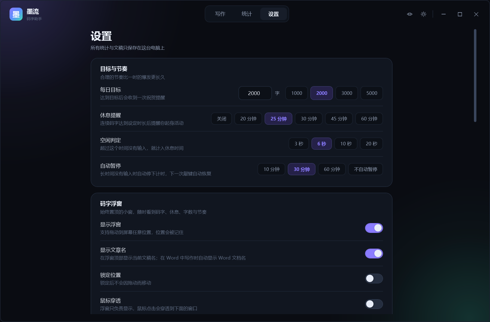
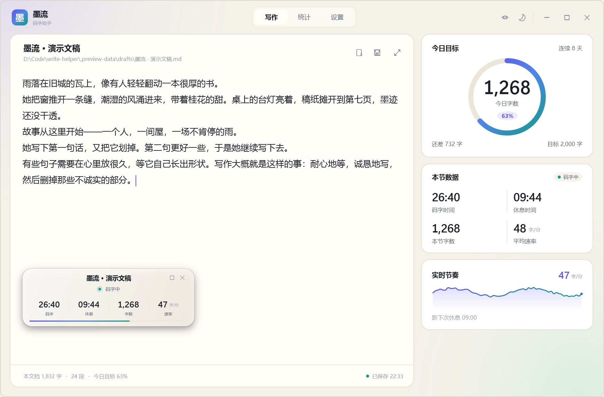

# 墨流 · InkFlow

> 写给写作者的 Windows 码字助手：一个安静的编辑器、一只常驻浮窗、一套诚实的统计。


墨流把「码字」拆成四个最朴素的数字：**码字时间、休息时间、码字字数、速率**。这四个数字会常驻在一个可以拖来拖去的小浮窗里，写作时不必切换窗口，也不必打断思路去看统计。

它不接管你的写作软件，也不上传任何内容。所有记录都留在本机。

---

## 功能

### 常驻浮窗（核心）

- 四项实时指标：**码字时间 / 休息时间 / 本节字数 / 速率（字/分）**。
- 顶部居中、用较大字号显示**当前文章名**：内置编辑器跟随当前草稿文件名；切到 Word 或 TXT 编辑器时自动显示对应文档名。标题可以直接点击修改为固定显示名：改过之后不再自动跟随当前文档名，只改浮窗上的名字，不改文件名或 Word 文档名；留空保存可恢复自动跟随。可在 设置 → 码字浮窗 → 显示文章名 关闭。
- 浮窗右上角有**最小化 / 最大化 / 关闭**：只有鼠标悬停在浮窗上时才显示。最小化会把浮窗贴到最近的屏幕上下边缘，收成一条小长条（显示状态、文章名和字数）；长条可以拖动调整位置，悬停后点还原即可恢复，最大化展开或还原详情，关闭隐藏浮窗，隐藏后可用快捷键或托盘恢复。
- 展开后追加：今日目标进度、今日字数、最近六十秒节奏曲线、休息、主界面、暂停按钮。
- 拖动移动、双击展开/收起、锁定位置、鼠标穿透，位置/大小/展开状态都会被记住。
- **背景与文字透明度分开调**：设置 → 码字浮窗，可以让背景更通透而文字保持清晰，也可以单独压低文字透明度；互不影响。
- 深色「墨夜」与浅色「暖纸」两套主题，跟随主界面切换。
- 默认快捷键 `Ctrl+Alt+W` 显示/隐藏。若被其他软件占用，会自动回退到 `Ctrl+Alt+O` 或 `Ctrl+Shift+Alt+W`，并在提示与设置页里显示实际生效的组合。
- 浮窗不抢键盘焦点（`WS_EX_NOACTIVATE`），点击浮窗按钮不会打断编辑器输入；也不出现在 Alt+Tab 里。


### 专注编辑器

- 无边框窗口、圆角、双主题；Markdown / TXT 自动保存，默认每 2 秒检查一次，连续写作时也会定期落盘。
- 打开、另存为、拖放文件打开；支持 `Ctrl+S / Ctrl+O / Ctrl+N`。
- 字体（雅黑 / 宋体 / 楷体 / 等宽）与字号可调；`Ctrl + 滚轮` 快速缩放。
- 专注模式：`F11` 隐藏标题栏与侧栏、铺满工作区；`Esc` 退出。
- 打字即开始计时；空闲超过阈值自动进入休息；长时间无输入自动暂停，下一次敲键自动恢复。

### 统计

- 今日字数、码字时长、休息时长、平均速度、最高速度、休息次数。
- 近 14 天字数柱状图、本月累计、连续打卡天数、今日节奏曲线。
- 按天保存在本地 JSON 中，跨天自动切分。


### 系统集成

- 托盘常驻；关闭窗口默认收进托盘，计时与浮窗继续工作。
- 单实例：重复启动会唤起已有窗口。
- 全局按键监听（默认开启）：在 Word、Typora、VS Code 等软件里码字时，也能统计码字/休息时间。**只读取按键动作，不读取内容，不联网。**
- **Word 字数追踪（默认开启）**：Word 桌面版在前台时，读取当前文档的字数统计并同步到浮窗，因此在 Word 里码字也能看到字数与速率。只读统计，不读正文；需要 Word 正在运行，WPS / 网页版 Word 暂不支持。
- **TXT 字数追踪（默认开启）**：在记事本、Notepad++、WordPad、Sublime Text 等纯文本编辑器中读取当前文档文本并统计字数/速率；只在本机用于计数，不上传。编辑器需要在前台，并且通过 Windows 辅助功能（UI Automation）暴露文本；记事本已实测，VS Code 暂不支持。
- 外部字数估算（默认关闭）：按按键粗略估算**其他软件**的字数。中文输入法会让估算偏多，因此默认关闭；Word / TXT 请使用上面的精确追踪。
- 深/浅主题、提示音、关闭到托盘、浮窗透明度/缩放等都可以在设置里调整。

### 在 Word 里写作

1. 保持 **Word 桌面版**打开，并让 Word 处于前台；墨流浮窗右上角会出现一个 **Word** 标记。
2. 第一次识别到某个文档时只会建立基线——文档里原有的字数不会算进本次统计；之后新增的字数、速率会正常累加。
3. 切换 Word 文档、Word 重启或暂时切到别的软件时，基线会自动重建，不会把旧内容算成新写的字。
4. 在 设置 → 外观与系统 → **Word 字数追踪** 可以关闭。关闭后 Word 只计时间与休息，不计字数。
5. Windows 的虚拟桌面彼此隔离：浮窗只在它所在的那个桌面显示。如果 Word 在另一个虚拟桌面，把墨流窗口拖到 Word 所在桌面（或把 Word 移回墨流所在桌面），才能一边写一边看到浮窗。

> 实现上调用的是 Word 自己的字数统计（`ComputeStatistics`），只读取字数与文档路径，不读取也不上传正文。

### 在记事本 / TXT 编辑器里写作

1. 让 **记事本、Notepad++、WordPad 等纯文本编辑器**处于前台；墨流浮窗右上角会出现 **TXT** 标记，文章名显示当前 `.txt` 文件名。
2. 第一次识别某个文件时只建立基线——文件里原有的内容不会算成新写的字；之后新增的字数、速率会正常累加。切换文件会自动重建基线。
3. 只支持能通过 Windows 辅助功能（UI Automation）暴露文本的编辑器；**记事本已实测**。VS Code 暂不支持；其他编辑器是否可用取决于它的辅助功能实现。
4. 在 设置 → 外观与系统 → **TXT 字数追踪** 可以关闭。关闭后 TXT 编辑器只计时间与休息，不计字数。
5. 中文输入法组字中同样不计字数，上屏后才计入；读取只在本机进行，用于字数统计，不上传。
6. 和 Word 一样，浮窗需要和编辑器在同一个 Windows 虚拟桌面，才能一边写一边看到。




---

## 快速开始

### 直接运行

如果你已经拿到发布好的 `InkFlow.exe`，或本地执行过下面的发布命令，双击 **`启动墨流.cmd`** 即可；仓库本身不提交构建产物，克隆后请从源码运行。

需要 Windows 10/11 和 **.NET 9 Desktop Runtime**（从源码构建还需要 .NET 9 SDK）。

### 从源码运行

```bash
git clone git@github.com:KIKIdoUlovemeRUriding/write_counter.git
cd write_counter
dotnet build InkFlow.sln -c Debug
dotnet run --project src/InkFlow/InkFlow.csproj
```

### 发布

```bash
dotnet publish src/InkFlow/InkFlow.csproj -c Release -r win-x64 --self-contained false \
  -p:PublishSingleFile=true -p:IncludeNativeLibrariesForSelfExtract=true \
  -p:DebugType=None -p:DebugSymbols=false -o publish
```

---

## 快捷键

| 按键 | 作用 |
| --- | --- |
| `Ctrl + Alt + W` | 显示 / 隐藏浮窗（被占用时自动回退，见设置页） |
| `Ctrl + Alt + T` | 浮窗鼠标穿透开关 |
| `Ctrl + Alt + Space` | 暂停 / 继续计时 |
| `Ctrl + Alt + M` | 唤起主界面 |
| `Ctrl + S` | 保存文稿 |
| `Ctrl + O` | 打开文稿 |
| `Ctrl + N` | 新建文稿 |
| `Ctrl + Shift + S` | 另存为 |
| `F11` | 进入 / 退出专注模式 |
| `Esc` | 退出专注模式 |

> 浮窗的「鼠标穿透」开启后，浮窗不再接收鼠标事件；用 `Ctrl+Alt+T` 恢复。
> 如果主快捷键被占用，墨流会按 `Ctrl+Alt+O`、`Ctrl+Shift+Alt+W` 的顺序尝试，并告诉你实际启用的是哪一个。

---

## 统计口径

- **字数**：不计空白的字符数，标点也计入，接近中文码字的常用口径。字数来源有四类：内置编辑器（精确）、Word 桌面版（Word 统计）、TXT / 纯文本编辑器（读取当前文本）、其他软件（默认不计字数，可手动开启「外部字数估算」，但中文输入法下不准确）。
- **中文输入法**：拼音/候选字还在组字框里、尚未上屏时，不计字数，也不会自动保存；按空格或选词上屏后才计入。取消组字不会把拼音留在文档或统计里。
- **Word 字数**：使用 Word 的字符统计（`wdStatisticCharacters`）。识别到文档时先建基线，只统计之后的增量；切文档会重新建基线。
- **TXT 字数**：读取当前前台纯文本编辑器的完整文本，按非空白字符计数；识别文件时建基线，只统计之后的变化；切换文件重建基线。
- **码字时间**：只有开始打字后才计时。最后一次按键后的空闲时间在阈值内（默认 6 秒）计入码字时间，超过则计入休息。
- **休息时间**：会话开始后没有计入码字的时间；主动暂停期间不累计。
- **速率**：最近 60 秒的滚动速度，单位字/分；平均速度为本节字数 ÷ 本节码字分钟数。进入休息、休息模式或暂停后，速率保持最后一次码字时的值，不再随时间衰减；恢复码字后重新按滚动窗口计算。
- **休息**：连续空闲满 60 秒记作一次休息。连续码字达到设定时长（默认 25 分钟）会弹出休息提醒；如果继续写，5 分钟后再次提醒。
- **暂停**：手动暂停会冻结码字与休息计时；长时间无输入（默认 30 分钟）会自动暂停，下一次敲键自动恢复。
- **新建一节**：清零本节统计，今日累计不变；「清空今日数据」才会清掉今天的全部记录。
- 功能键、方向键、组合键（Ctrl/Alt/Win）不会被当作码字活动；只有可打印字符和编辑键才会启动计时。

---

## 数据与隐私

| 内容 | 位置 |
| --- | --- |
| 设置 | `%AppData%\InkFlow\settings.json` |
| 每日统计 | `%AppData%\InkFlow\history.json` |
| 默认草稿 | `%Documents%\墨流\我的草稿.md`（可在设置里改目录） |

- 没有账号，没有云端，没有遥测。
- 全局监听只判断「有没有按键、按了什么键位」，不记录输入内容，也不读取剪贴板。
- 数据目录可以用环境变量 `INKFLOW_DATA_DIR` 指向别处（便携模式 / 测试用）。

---

## 技术实现

- **.NET 9 + WPF**，零第三方 NuGet 依赖；托盘图标使用 WinForms `NotifyIcon`（唯一用到 WinForms 的地方）。
- 不透明主窗口 + DWM 圆角/深色边框；浮窗使用逐像素透明、`WS_EX_NOACTIVATE`、`WS_EX_TOOLWINDOW`，因此不抢焦点、不占 Alt+Tab。
- Win32 细节：`WH_KEYBOARD_LL` 全局键盘钩子、`RegisterHotKey`、`DwmSetWindowAttribute`、`WM_GETMINMAXINFO`（修正无边框窗口最大化时被任务栏遮挡的问题）。
- 统计引擎与视图分离：`StatsEngine` 负责秒级计数、速度滑动窗口、休息/提醒状态机；`AppState` 负责设置、文稿元数据、图表数据与命令。
- 两套 `ResourceDictionary` 主题通过 `DynamicResource` 热切换；所有图表控件（进度环、仪表条、折线）都是自绘 `FrameworkElement`，无图表库。
- 设置与统计原子写入（临时文件 + 替换），避免崩溃时写坏文件。

## 项目结构

```
src/InkFlow/
  App.xaml / App.xaml.cs          启动、托盘、全局热键、单实例、提示
  AppState.cs                     应用级状态与命令
  Models/                         设置、每日记录
  Services/                       统计引擎、历史、设置、键盘钩子、热键、托盘、窗口特效
  Views/                          主窗口、浮窗、Toast
  Controls/                       ProgressRing、Meter、Sparkline
  Themes/                         Dark / Light / Controls 样式
  Converters/                     绑定转换器
  Assets/app.ico                  应用图标
docs/screenshots/                 文档截图
publish/                          本地发布输出（不提交）
tools/                            应用图标生成脚本
```

## 已知边界

- Windows 10/11 限定；未做 macOS/Linux 版本。
- Word 字数追踪需要 Microsoft Word 桌面版正在运行；WPS、网页版 Word、其他办公软件不支持（其他软件默认只统计时间/休息）。
- TXT 字数追踪依赖 Windows UI Automation；不支持未暴露文本的编辑器；VS Code 暂不支持。记事本已实测，Notepad++ / WordPad 等取决于其辅助功能实现。
- 浮窗使用半透明渐变而不是系统 Acrylic：在远程桌面/虚拟显示器上更稳定，拖动时不卡顿。
- 统计按本机时钟与日期切换；跨时区使用未做特殊处理。

---

## 许可证

本项目以 [MIT License](LICENSE) 开源。

---

如果它让你少看了几次字数、多写了几个字，那就够了。
